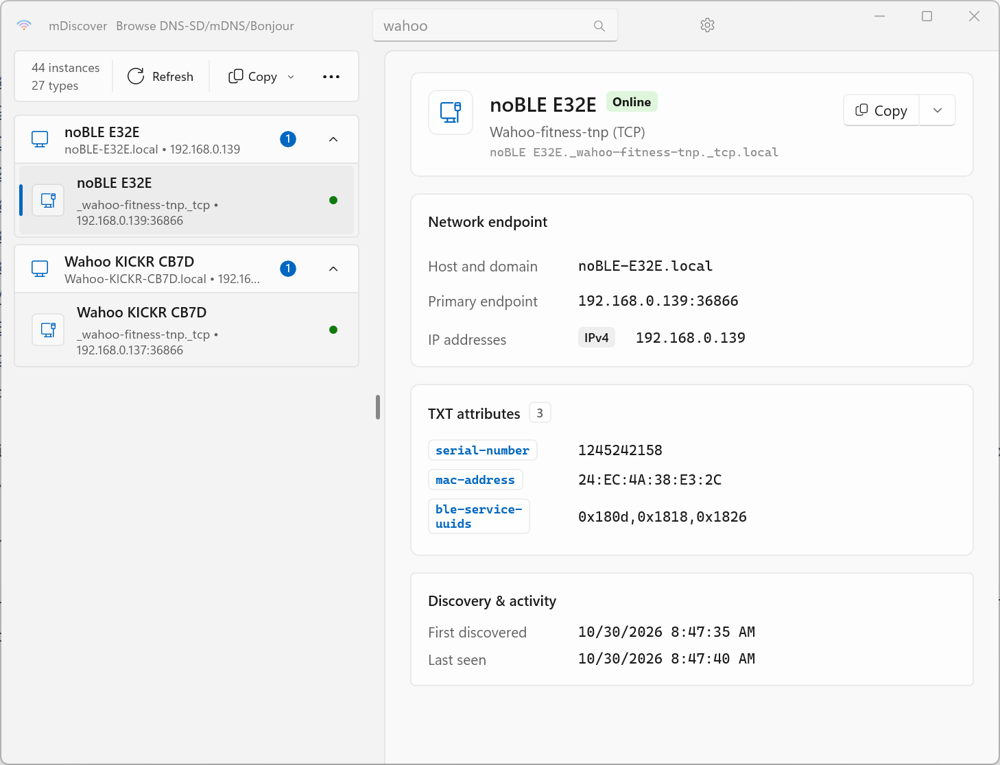
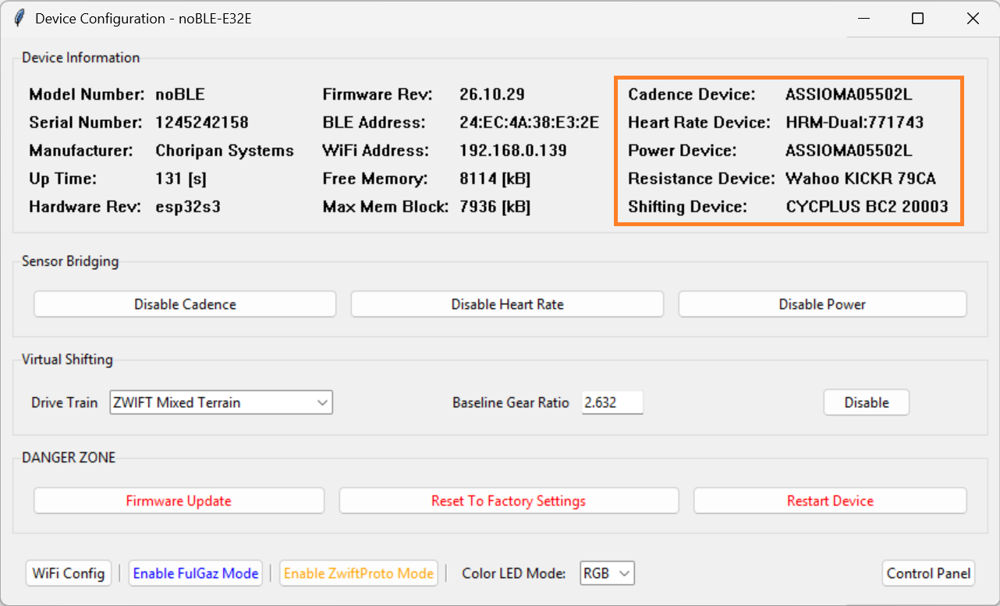
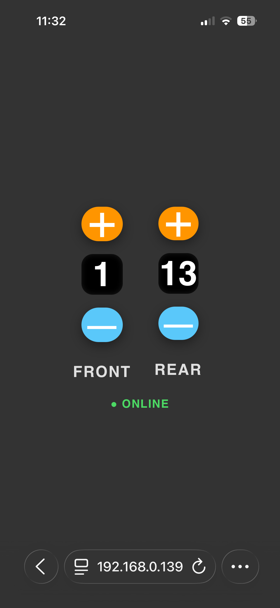
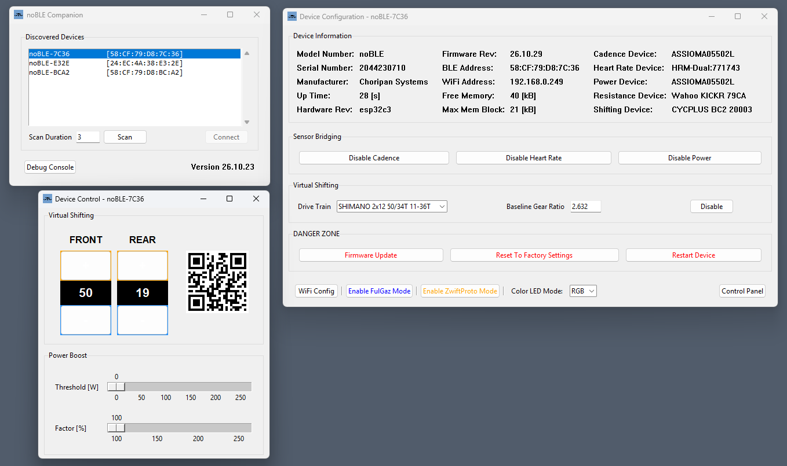
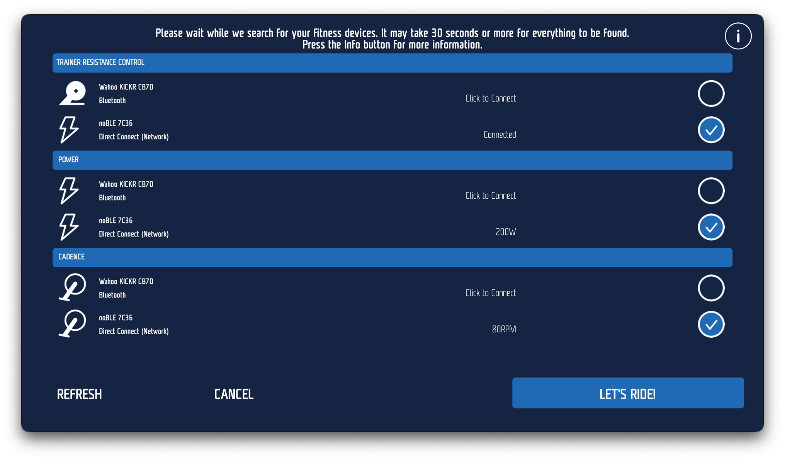
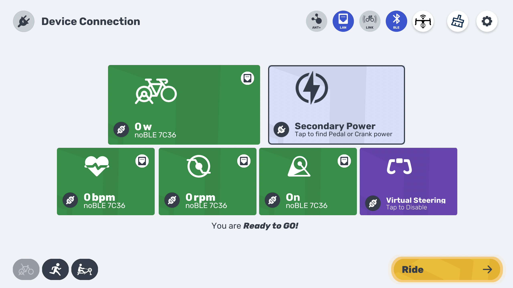
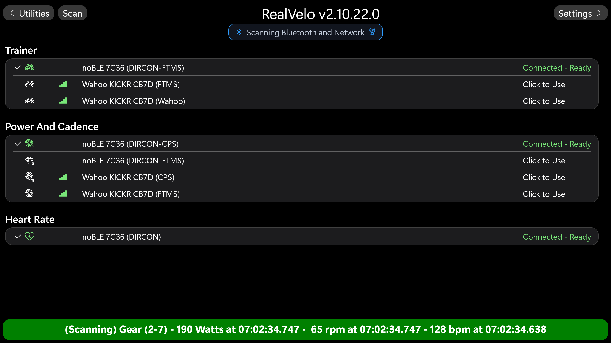
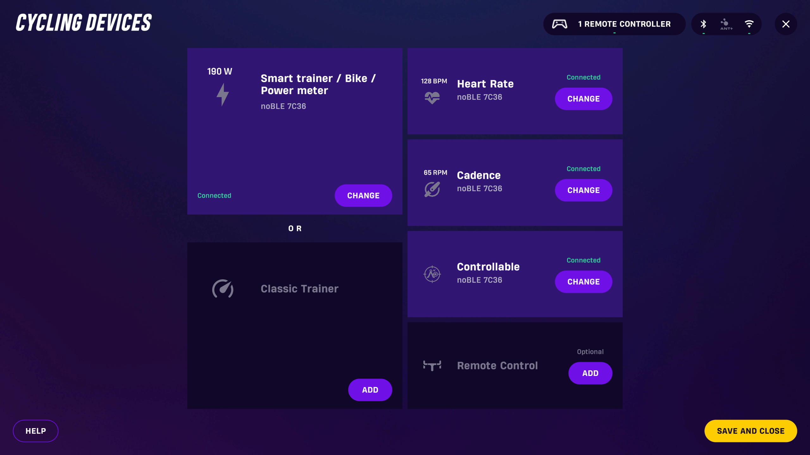
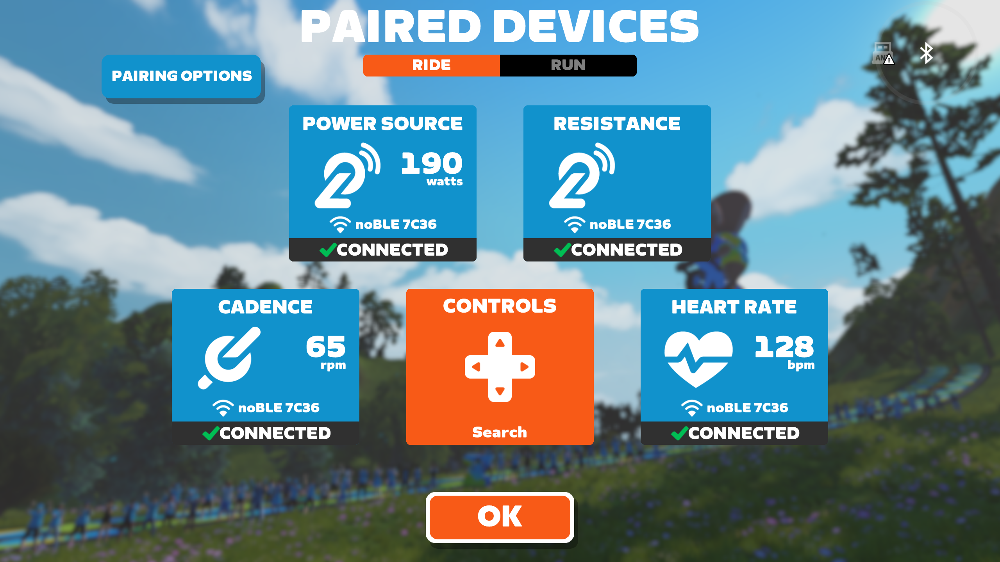

# 1. Introduction

noBLE is a device that can give a "new life" to your indoor bike trainer, by adding new features to it, and helping you solve real-world problems with your indoor cycling setup.

These are some of noBLE's features:

* It adds Direct Connect (DIRCON) support over WiFi, which is supported by most cycling apps as a preferred option over Bluetooth.
* It can bridge over DIRCON up to 3 external Bluetooth sensors, such as a heart rate monitor, cadence, power meter.
* It adds FTMS support to older trainers that don't have native support for it.
* It adds Virtual Shifting support, using a configurable drivetrain, to trainers that don't have native support for it.
* It is configured by a simple companion app that runs on Windows, macOS, and Linux.
* It runs on low-cost off the shelf hardware.
* It is a standalone device that runs off USB power.

The following sections describe each feature in more detail.

 

# 2. Direct Connect

Most virtual cycling apps connect to the smart indoor bike trainer via Bluetooth Low Energy (BLE) and use the BLE standard Fitness Machine Service (FTMS) and the Cycling Power Service (CPS) to interact with the trainer.

BLE is ubiquitous, supported by all hardware devices where those virtual cycling apps run.

However, being a low-power wireless technology operating in the crowded 2.4 GHz band, BLE communications are subject to occasional connection drops due to either a weak signal or to interference with other nearby devices operating in the same 2.4 GHz band. This is not good when you are in the middle of a virtual cycling activity!

To address these issues, Wahoo Fitness ® developed the Direct Connect (DIRCON) protocol that essentially allows the trainer control and the sensor data to be exchanged over WiFi or wired Ethernet, instead of BLE.

For an in-depth review of DIRCON, you can read [this](https://www.dcrainmaker.com/2021/01/wahoo-starts-shipping-kickr-2020-direct-connect-cable-hands-on-details.html) blog post by DC Rainmaker, or watch [this](https://youtu.be/XtIM5675dLo?si=B5nM_biNNlvfmuu2) Youtube video from Shane Miller.

As of the time of this writing, DIRCON is supported by the following virtual cycling apps:

- FulGaz
- MyWhoosh
- RealVelo
- Rouvy
- Wahoo SYSTM
- Zwift

and is available in the following indoor bike trainers:

| Brand | Model | Wired | WiFi |
|-------|-------|----|----|
|Elite|Justo|  |  |
|Elite|Justo 2|  |  |
|Elite|Avanti|  |  |
|JetBlack|Victory|  |  |
|Tacx|Neo 3M|  |  |
|Wahoo|KICKR V5|  |  |
|Wahoo|KICKR V6|  |  |
|Wahoo|KICKR BIKE V2|  |  |
|Wahoo|KICKR MOVE|  |  |
|Wahoo|KICKR BIKE SHIFT|  |  |
|Wahoo|KICKR CORE V2|  |  |

The trend in the smart trainer market is moving toward built-in Wi-Fi connectivity, because it offers a more stable and faster connection than traditional Bluetooth.  Even though WiFi uses the same 2.4 GHz band as Bluetooth, WiFi's nominal radio signal power is much stronger than Bluetooth's: 30-100 mW versus 1-6 mW.

Notice that some very popular indoor trainers (such as the Wahoo KICKR CORE V1, or the Elite Direto XR) are missing from that table.  noBLE adds DIRCON support over WiFi to all those trainers!

DIRCON uses Multicast DNS (mDNS), also known as Bonjour or ZeroConf, to advertise itself on the local network using the "_wahoo-fitness-tnp._tcp.local" service.  The screenshot below shows the mDiscover app (an mDNS Browser app for Windows) having discovered two DIRCON devices on the local network: a Wahoo KICKR V5 and a noBLE device.  Notice how the noBLE device advertises the Heart Rate Service (UUID 0x180d) in addition to the Fitness Machine Service and the Cycling Power Service (UUID's 0x1826 and 0x1818, respectively.)

 

 

# 3. Bluetooth Sensor Bridging

Some modern indoor trainers can bridge Bluetooth sensors. This is a useful feature because it reduces the number of simultaneous Bluetooth connections the virtual cycling app needs to handle.  This issue is particularly important when the virtual cycling app runs on an AppleTV 4K device, which supports only 2 simultaneous Bluetooth connections, one used to connect to the trainer and the other one typically used to connect to a heart rate monitor.

noBLE can bridge up to 3 external Bluetooth sensors, **in addition** to the indoor trainer.  This allows you to fully utilize your gear, by pairing noBLE with a heart rate monitor, a crank cadence sensor, and a pedal power meter, all at once.  

While all trainers report power, not all of them report cadence, such as on the older KICKR SNAP and KICKR V1 trainers.  And even when the trainer reports cadence, its value may not be accurate under some riding conditions.  That is the case with the KICKR V5, which reports inaccurate cadence values when the gear ratio is below 1:1, as when you are on the smaller 34T chainring and the largest 36t cassette.  Being able to bridge an accurate crank arm cadence sensor solves those problems.

When cadence sensor bridging is enabled, noBLE will scan for and connect to a device that advertises the Bluetooth "Cycling Speed and Cadence Service" (CSCS).  It will use the data in the CSCS notifications either to insert or to replace the cadence data sent in the FTMS "Indoor Bike Data" or the CPS "Cycling Power Measurement notifications".

When power sensor bridging is enabled, noBLE will scan for and connect to a device that advertises the Bluetooth "Cycling Power Service" (CPS). Once the scan is complete, noBLE queries the CPS devices it found (including the one in the trainer itlsef) and selects the "best" one to use to report the power data.  In most cases the best one is the external pedal or crank power meter device, as they tend to be more accurate and to support power balance.

When heart rate sensor bridging is enabled, noBLE will scan for and connect to a device that advertises the Bluetooth "Heart Rate Service" (HRS).

In all cases, the Bluetooth services from the bridged devices are made available over DIRCON, thus reducing the number of simultaneous Bluetooth connections the virtual cycling app needs to handle.

The screenshot below shows the Device Configuration window of the noBLE Companion app, where you can see the 4 Bluetooth devices noBLE is paired with: Wahoo KICKR used for trainer resistance, Favero Assioma power meter pedals used for power and cadence, Garmin HRM Dual used for heart rate, and CYCPLUS BC2 controller used for gear shifting:

 

 

# 4. Fitness Machine Service

Early smart indoor trainers were managed using the ANT+ "Fitness Equipment Controller" (FE-C) protocol.  The problem with ANT+ is that it isn't supported by the typical hardware devices (PC, Mac, AppleTV, etc) used to run the virtual cycling apps, so it forces the user to have to purchase an [ANT+ USB adapter](https://www.wahoofitness.com/devices/indoor-cycling/parts-components/usb-ant-kit-buy) in order to use ANT+.

Before the Bluetooth SIG released the "Fitness Machine Service" (FTMS) specification, some trainers (such as Tacx) allowed the use of FE-C over Bluetooth instead of ANT+ to control the trainer, and used CPS to report power and cadence.  And some early Wahoo trainers (such as the KICKR SNAP and KICKR V1) used a private extension to the CPS to control the trainer, by adding a new control point characteristic with the private 128-bit UUID a026e005-0a7d-4ab3-97fa-f1500f9feb8b.

noBLE can add support for FTMS to any old trainer that has no native support for it, but does have support for either FE-C over Bluetooth or the Wahoo extension to the CPS. This feature is useful, as it allows the trainer to be used with virtual cycling apps which require FTMS, such as MyWhoosh.

 

# 5. Virtual Shifting

Virtual shifting was originally intoduced in high-end smart bikes, such as the Wattbike Atom (2017), the Tacx Neo Bike (2019), and the Wahoo KICKR Bike (2019).  But the feature was popularized in late 2023 when Zwift introduced its "Hub One" indoor trainer, with the CLICK controller and the single sprocket "Zwift Cog".  

More recently Zwift licensed its technology to other indoor trainer vendors, which incorporated it in their "Zwift Ready" models, such as the Wahoo KICKR CORE V2, Tacx Neo 2T, Elite Justo, etc.

Virtual shifting offers several distinct benefits over traditional mechanical shifting for indoor cycling. The primary advantages include:

* **Quieter Operation:** Indoor training amplifies drivetrain noise due to acoustics in enclosed rooms. Because virtual shifting locks the chain onto a single sprocket in a straight line, it reduces the metallic clanking, chain rubbing, and derailleur noise associated with mechanical shifting.

* **No Chain Drops or Missed Gears:** Changing gears under heavy climbing loads indoors often leads to skipped teeth, grinding, or dropped chains. Virtual shifting happens instantly and flawlessly via software, meaning you can change gears while pushing maximum sprint wattage without any mechanical strain.

* **Universal Bike Compatibility:** A traditional direct-drive trainer requires a cassette that matches your specific bike's drivetrain (e.g., an 11-speed Shimano cassette won't work flawlessly with a 12-speed SRAM bike). Virtual shifting utilizes a single-sprocket setup, allowing a 7-speed commuter bike, a 10-speed mountain bike, and a 12-speed road bike to share the exact same trainer without changing parts.

* **Customizable Gearing Layouts:** Mechanical bikes are physically limited by the chainrings and cassette sizes installed on them. With virtual shifting, you can use software settings to instantly swap between a standard road layout, a compact climbing setup, or a 1x gravel configuration, and even customize the exact number of teeth on your virtual gears to match the profile of a specific virtual course.

* **Reduced Component Wear and Maintenance:** Shifting gears under load causes friction that accelerates chain and cassette wear. By keeping the chain static on a single cog, you drastically extend the lifespan of your bike’s drivetrain components and significantly reduce the time spent adjusting finicky indexing barrels and derailleur cables.

noBLE adds virtual shifting support to older indoor trainers that do not have native support for it.  And you can even use it with virtual cycling apps (such as FulGaz) which do not support virtual shifting themselves!

noBLE supports several 2x12 and 1x12 drivetrains from Shimano and SRAM, plus the default 1x24 "Mixed Terrain" drivetrain used by the Zwift Game app.  

The drivetrain type can be changed during the ride, and virtual shifting as a whole can also be enabled/disabled during the ride.

It is important to note that noBLE's virtual shifting feature is totally transparent to the virtual cycling app, and does not affect its normal operation in any way.

The gear shifting can be done in multiple ways:

* Using the [CYCPLUS BC2](https://www.cycplus.com/products/bc2-shifter) or the [ThinkRider VS200](https://thinkrider.com/products/vs-200-virtual-shifting-controller) controllers.
* Using a web browser connected to the noBLE device.
* Using the noBLE Companion app.

The screenshot below shows the Safari browser on an iPhone, connected to noBLE's WebSock server.  Tapping on any of the buttons allows the user to up-shift or to down-shift either the chainring or the sprocket:

 

 

# 6. Companion App

The noBLE Companion app is used to setup and manage a noBLE device.  The app currently runs on Windows, macOS, and Linux, and connects to the noBLE device via Bluetooth.

Below is a list of some of the things you can do with it:

* Set the WiFi credentials to allow noBLE to connect to your home network
* Enable optional features, such as BLE sensor bridging and virtual shifting
* Perform virtual gear shifting during the ride
* Dynamically adjust the Power Boost threshold and level during the activity

The screenshot below shows the noBLE Companion app running on Windows 11, with the app's main window showing 3 noBLE deices discovered over Bluetooth, and with the app connected to the noBLE-7C36 device:

 

 

A detailed description of the noBLE Companion app can be found [here](https://github.com/choripan-systems/Documentation/blob/main/nobleComp/App-Install-On-Windows.md).

 

# 7. noBLE at Work

The screenshots below show several virtual cycling apps using noBLE for trainer control, power, cadence, and heart rate.

 

 

 

 

 

 

Dummy commit #3 to test the autoconversion to PDF

---

<!-- LastEdited -->
Last Edited: 2026-11-01 15:31:32 UTC
<!-- /LastEdited -->

